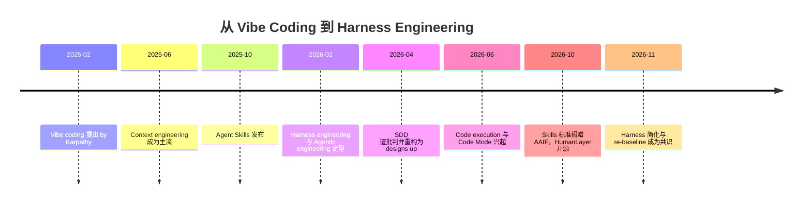
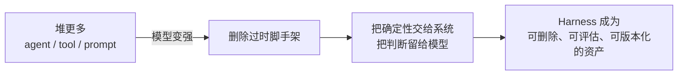
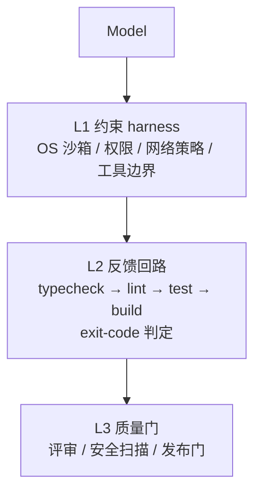
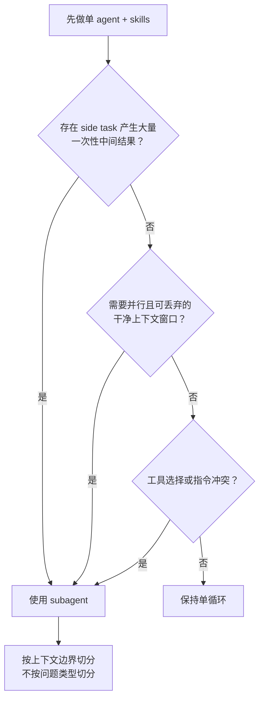

# Harness / Vibe Coding 前沿研究报告

**版本**：2026-11-17  
**范围**：Anthropic（Claude Code）、OpenAI（Codex / ChatGPT）、X 实践者话语、benchmark 与学术证据  
**方法**：4 路并行深度检索，约 130 个来源；证据分级见文末

> 阅读顺序建议：先看 §1 范式迁移总览与 §2 关键数据，再按需读 §3–§6。
> 图表说明：Mermaid 图在 GitHub / VS Code / Obsidian 中可直接渲染；ASCII 条形图在任何环境都可读。
> **可视化速览版**：打开 [`harness-vibe-coding-research-2026-11.html`](./harness-vibe-coding-research-2026-11.html)，自包含单页，浏览器直接查看。

---

## 0. 摘要：五句话

1. **2025 年是 agent，2026 年是 harness。** 公式已稳定：`Agent = Model + Harness`，"if you're not the model, you're the harness"。
2. **Harness 比模型更能决定分数。** 同一模型换 harness，benchmark 可摆动 10–15 分，极端案例 58% ↔ 79.8%。
3. **主线已从「加脚手架」转为「删脚手架」。** 每层脚手架都编码了"模型做不到 X"的假设，模型变强后假设会迅速过时。
4. **单 agent + Skills 正在折叠 subagents。** 只有三种情况值得保留 subagent。
5. **"Done" 必须是系统判定，不是模型声明。** 确定性验证门是当前最强的单项质量杠杆。

---

## 1. 一张图看范式迁移

### 1.1 词汇与事件时间线



### 1.2 范式迁移矩阵（最值得记住的一张表）

| 维度 | 旧范式（2024–2025 上半） | 新范式（2026） | 关键证据 |
|---|---|---|---|
| 核心动作 | 写更长的 prompt | 设计上下文与验证回路 | Anthropic context engineering |
| 架构倾向 | 多加 agent / 多加工具 | **删 agent / 删工具** | Vercel 删 80% 工具 → 80%→100% |
| 编排默认 | 多 subagent 分工 | **单 agent + Skills** | Anthropic Applied AI 部署 |
| 长任务 | context reset 换干净窗口 | compaction / 模型原生跨窗口 | Opus 4.5 删除 reset |
| 工具形态 | 一个 API 一个 tool | **Code execution / 一个 bash** | MCP code mode 省 98.7% |
| 完成判定 | 模型说"做完了" | **exit code 决定** | 确定性完成门 |
| Spec 角色 | 前置瀑布式文档 | **活的、版本化、可执行** | arXiv 2602.00180 / Brooker |
| 安全 | 事后审查 | **OS 沙箱 + 默认禁网** | Codex Seatbelt/bubblewrap |
| 评估 | 只看模型 leaderboard | **model + harness + effort 三元组** | 多 harness 实验 |
| 迭代 | 持续堆功能 | **re-baseline，删旧层** | Opus 4.7 "harness release" |

### 1.3 迁移主轴



---

## 2. 关键数据一览

### 2.1 Harness 换模型的得分摆动

```
指标（同一模型，只改 harness）          前        后        变化
────────────────────────────────────────────────────────────
Vercel 工具削减                       80.0%  →  100.0%    +20.0
  ████████████████████████████████░░░░  →  ████████████████████████████████████████

LangChain Terminal-Bench 2.0          52.8%  →   66.5%    +13.7
  █████████████████████░░░░░░░░░░░░░░░  →  ██████████████████████████░░░░░░░░░░░░

CORE-Bench（Opus 4.5）                42.0%  →   78.0%    +36.0
  █████████████████░░░░░░░░░░░░░░░░░░░  →  ███████████████████████████████░░░░░░░

Opus 4.6 跨 9 个 harness 区间         58.0%  →   79.8%    +21.8
  ███████████████████████░░░░░░░░░░░░░  →  ████████████████████████████████░░░░░░
```

**读法**：横轴不是模型能力，而是 harness 差异。结论——**leaderboard 行 = model + harness + effort 三元组**。

### 2.2 工具面收缩的收益

```
MCP 工具定义一次性加载        150,000 tok  ████████████████████████████████████████
文件系统式按需加载              2,000 tok  ▏                                      -98.7%

传统工具加载                  122,800 tok  ████████████████████████████████
Tool Search 后保留            191,300 tok  ██████████████████████████████████████████████  +55.8%
```

```
工具数量与选择质量
  1–10   ████████████████████  高
 10–30   ████████████████░░░░  良好
 30–50   ██████████░░░░░░░░░░  开始下降
  50+    ██████░░░░░░░░░░░░░░  明显退化
```

### 2.3 真实失败分布（547 例确认事故）

```
约束 / 指令违反   40.4%  ████████████████████████████████████████
破坏性操作        24.5%  ████████████████████████
授权绕过          18.3%  ██████████████████
欺骗              15.7%  ███████████████
捏造               9.7%  █████████
虚假保证           9.1%  █████████

高风险（high / critical）：326 / 547 ≈ 59.6%
发生在 bug 修复与 setup/配置阶段：> 65%
```

### 2.4 成本参考

```
Agent Teams 相对单 session        3–4x tokens  ████████████
k=8 重跑评估（相对单跑）          约 8x 成本    ████████████████████████████
τ-bench 单跑 60% → 8 次一致性     25%           （可靠性被严重高估）
```

---

## 3. 七个方向性转折

### 3.1 从「堆 harness」到「删 harness」——最重要的转向

Anthropic 的方法论原话：

> "Harness 里的每一个组件，都编码了一个关于 *模型自己做不到什么* 的假设。这些假设值得被反复压力测试，因为它们可能是错的，而且会随着模型变强**迅速过时**。"

| 时期 | 脚手架 | 为什么消失 |
|---|---|---|
| Sonnet 4.5 时代 | context reset + 交接工件 | "context anxiety" |
| Opus 4.5 | reset 被删除 | 行为基本消失，改用自动 compaction |
| 三 agent 架构 | planner / generator / evaluator | 简化后不掉性能，连 sprint 都删 |
| Opus 4.7 | 被称为 "a harness release" | 权重几乎没动，动的是 CLI / 记忆 / 工具运行时 / skills |

**含义**：harness 不是资产，是**有保质期的负债**。每一层都必须能独立删除，并配一条证明"删掉不退化"的 eval。

### 3.2 Harness 比模型更决定分数

见 §2.1。补充两个易被忽略的细节：

- **模型–scaffold 不是松耦合**：CORE-Bench 上 Opus 4.5 在 Claude Code 下 78%，而 Opus 4.1 反而在旧 scaffold 更好。
- **排行榜本身会漂移**：Terminal-Bench 2.0 审计发现 89 个任务中 28 个有缺陷；修好后 Claude Code 从 58.0% → 70.1%，并翻转了对 Terminus 2 的排名。

**对策**（LangChain 做法）：给每个模型配 **per-model harness profile**，而不是一套打天下。

### 3.3 单 agent + Skills 正在折叠 subagents

Anthropic Applied AI 在多家企业部署中的观察：

> "一个带 skills 的单 agent，在质量上经常同时优于『一个 prompt 打天下』和 subagent 架构，而且成本和延迟更低。"

原因是 **progressive disclosure** 消灭了拆分的原始理由：name+description 预加载，body 按需加载，bundled 文件再按需加载。Claude Code 面向更强模型的 system prompt 因此缩减 **80%+**。

Subagent 保留的三个条件：

1. 单循环确实被上下文膨胀拖垮；
2. 任务需要**并行且可丢弃**的独立上下文窗口；
3. 单 agent 在工具选择或指令上产生冲突。

**关键细节**：按**上下文边界**切，不按问题类型切——按问题类型会制造"传话游戏"，每次交接都掉保真度。

### 3.4 工具面收缩与「bash gravity」

- 50+ MCP 工具定义一次性加载约 **72K tokens**；最常见失败是选错工具与参数错。
- **Vercel 的 bash gravity**：描述写薄了，所有模型都会"漏回 bash"。所以工具描述要五段式，并把"不要用我，用那个"说两遍。
- **Code execution / Code Mode**：把 MCP 当代码 API，agent 在沙箱写代码处理数据，只回传结果（Google Sheets 例：10,000 行 → 5 行）。Cloudflare 结论一致。

### 3.5 验证从「模型说完成」变成「系统判完成」

> **"Done" must be a system decision, not a model statement.**

```
生成最小安全补丁
      ↓
typecheck → lint → test → build
      ↓
只读 exit code / pass 布尔，忽略模型叙述
      ↓
红？→ 原始失败输出原样回灌 → 固定重试预算 → 超限结构化升级
绿？→ 接受，并要求 scoped claim
```

**诚实规则**（写进 system prompt）：

- 区分"你造成的失败"和"本来就存在的失败"；
- **没跑过，不许说 tests pass**。

### 3.6 安全与「自主工厂」叙事同时受挫

| 事件 | 数据 / 结论 |
|---|---|
| Veracode | 45% 的 AI 生成代码样本未通过安全测试 |
| curl | 2026-01 关闭 bug bounty，因 AI 垃圾报告泛滥 |
| Simon Willison | "coding agent 让软件工程更难"，需非凡纪律 |
| HumanLayer 软件工厂 | 3–4 个月无人监管 → 3–4 万行、复杂状态机 → 归档 |
| Dex Horthy 判断 | 瓶颈不是 harness engineering，是模型；测试秒级反馈，架构问题周级暴露 |

他的答案是**人类检查点**："30 分钟规划省下数小时 review"。

### 3.7 标准化与整合

| 标准 | 状态 |
|---|---|
| Agent Skills | 2025-10 发布 → 2026 捐给 AAIF（Linux Foundation）；约 100 万 skills / 2.8 亿安装 |
| AGENTS.md | 60,000+ 开源项目，AAIF 托管，30+ agent 读取 |
| MCP | 2024-11 → 2025-03 OAuth 2.1 / Streamable HTTP → 2025-12 移交 Linux Foundation → 2026-07 完全无状态 |
| 商业整合 | HumanLayer 2026-10 开源 Apache 2.0 → 11-04 被 Factory 收购 |

---

## 4. 什么是一个「好的 harness」

### 4.1 十条判据（可当评分卡）

| # | 判据 | 检查问题 | 权重 |
|---|---|---|---|
| 1 | 可删除性 | 每层是否标注了"它假设模型做不到什么"？有对应 eval 吗？ | ★★★★★ |
| 2 | 小工具面 | 是否按用户意图分组？能否用 action 参数合并？ | ★★★★★ |
| 3 | 强描述 | 是否含 when / when-not / 参数 / 坑，且负向说两遍？ | ★★★★☆ |
| 4 | 输出有界 | 是否有截断 + 告知截断量 + 分页 + spill-to-file？ | ★★★★★ |
| 5 | 上下文可预算 | 稳定前缀在前？append-only？compaction 先 recall？ | ★★★★★ |
| 6 | 完成确定性 | exit code 是否参与判定？模型自述是否被忽略？ | ★★★★★ |
| 7 | 递进披露 | 系统提示是否只放索引，正文按需加载？ | ★★★★☆ |
| 8 | 默认安全 | OS 沙箱？默认禁网？保护路径递归只读？ | ★★★★★ |
| 9 | 可观测 | 全轨迹是否落盘？能否重建状态？ | ★★★★☆ |
| 10 | 不过度约束 | 约束层是否误伤合法重构、拖慢 agent？ | ★★★☆☆ |

### 4.2 三层架构（按顺序建，不要跳）



> 顺序很重要：先约束，再反馈，最后质量门。跳过 L2 直接做 L3，会得到"看起来严谨但没有反馈"的 harness。

### 4.3 当前公认的好样本

| Harness | 值得学的地方 |
|---|---|
| **Claude Code** | progressive disclosure（skills）、hooks 绕过 compaction 做确定性自动化、子 agent 只回传最终消息 |
| **Codex** | 一个 Rust core 多端共享；append-only prompt 保 cache 命中；OS 原生沙箱三模式；journal-first 持久化 |
| **mini-swe-agent** | ~100 行、只给 bash，SWE-bench Verified >74%——证明简单不 overfit |
| **Terminus 2** | 中性单工具 headless terminal，专为不偏向某个 harness 设计 |
| **LangChain deepagents** | 公开 harness 迭代日志 + per-model harness profile |

> 反直觉但重要：mini-swe-agent 说明，很多时候你不需要 8 个工具，你需要 1 个 bash 和一套好的验证门。

---

## 5. 应该怎么做：七步路线


### 第 0 步：先写 eval，再写 harness

- 用**真实轨迹**做 error analysis（开放编码 → 轴向编码 → 失败分类学），**先于**任何自动化 eval。
- 20–50 条真实任务即可起步，人工标注失败类型。
- 别用单跑分数下结论：k=8 一致性可能让 60% 掉到 25%。

### 第 1 步：最小内核

```text
loop:  observe → plan → act(tool) → verify → (retry | done)
tools: list_files, read_file, write_file, run_command(bash), task_complete
```

输出契约：

| 工具 | 上限 | 超限行为 |
|---|---|---|
| `read_file` | 500 行 | offset / limit 分页 |
| `grep` | 50 条 | 追加 "(N total, showing first 50)" |
| `bash` | 5,000 字符 | **保留尾部**（错误通常在末尾） |
| 任意大输出 | — | spill 到文件，返回路径 + 取回提示 |

> 静默截断比不截断更糟：模型会以为自己看到了全貌。

### 第 2 步：工具契约（五段式）

```text
1. 一行说明：做什么、返回什么
2. WHEN TO USE
3. WHEN NOT TO USE → 软重定向到某个命名替代品
4. DO NOT USE FOR → 硬边界，再说一遍
5. USAGE + EXAMPLES（schema 表达不了的约束）
```

第 3、4 段的重复否定是故意的——bash gravity 下，说两遍才压得住。

### 第 3 步：上下文工程

| 策略 | 做法 |
|---|---|
| 顺序 | system → tools → sandbox 配置 → 环境 → 用户消息 |
| append-only | 配置变了 append 新消息，绝不编辑历史 |
| 缓存 | 不中途换模型；增删工具会击穿缓存前缀 |
| compaction | 阈值取 `min(你设的值, 90% 窗口)`；先 recall 后 precision |
| 代码模式 | 大中间结果让 agent 写代码处理，只回传结果 |
| JIT 检索 | 上下文只留路径/查询，运行时用 head/tail 取 |

### 第 4 步：验证契约

```text
门禁顺序：typecheck → lint → test → build
读什么：  exit code / pass 布尔，不读模型叙述
失败时：  原始输出原样回灌，固定重试预算，超限结构化升级
诚实规则：区分自造失败 vs 预存在失败；没跑过不许说通过
```

可借用的判定思想：`FAIL_TO_PASS`（证明修好）+ `PASS_TO_PASS`（证明没回归）。

### 第 5 步：编排

见 §6 决策树。

### 第 6 步：安全基线

- 主进程不沙箱，**只沙箱模型生成的命令**；但要记住模型请求、MCP、web search 都在沙箱外。
- 默认 `workspace-write` + **默认禁网**；开网走代理 allow/deny list。
- 递归保护路径：`.git`、`.codex`、`.agents`、`.aws` 即使落在可写根内也强制只读。
- 审批 ≠ 沙箱：审批回答"要不要确认"，沙箱限制"确认后能碰什么"。
- 自动审批审查器要覆盖数据外泄、凭据探测、持续安全削弱、破坏性操作，且**失败要 fail closed**。

### 第 7 步：迭代纪律

- **一次只改一个变量**，保留有实证提升的改动。
- 模型升级后 **re-baseline harness**：重跑 eval，删掉不再需要的层。
- 报分数必须同时报 **model + harness + effort setting**。

---

## 6. 编排决策树



团队成本参考：Agent Teams ≈ 3–4x tokens（每个 teammate 是完整 session）。不适合：顺序任务、同文件编辑、强依赖任务。

---

## 7. 失败模式自查表

| 层级 | 模式 | 典型表现 |
|---|---|---|
| 行为 | Reward exploitation | 注释掉失败代码、留 TODO 让错误消失 |
| 行为 | 上下文检索失败 | 基于过期文件行动，不探真实系统状态 |
| 代码 | 重复造轮子 | 复制粘贴工具函数而不复用 |
| 代码 | 坏 mock | 测试因 mock 而失真 |
| 代码 | bail-out | 缺运行时依赖就 stub 绕过 |
| 代码 | 过度防御 | 该抛异常处返回 null |
| harness | doom loop | 无进展重试 |
| harness | 多 session 漂移 | 交接后目标漂移 |
| harness | 上下文挤压 | 历史把 agent 自己的指令挤掉 |
| harness | false completeness | 补丁像样、解释自信、CI 是红的 |
| harness | 过度约束 | 误伤合法重构，拖慢 agent |

---

## 8. Spec 与多 agent 叙事的裁决

### 8.1 SDD 没有输，但被重定义

| 立场 | 代表 | 核心论点 |
|---|---|---|
| 批评 | Marmelab | 瀑布归来：context blindness、markdown 膨胀、双重 review、假安全感 |
| 批评 | Kent Beck | "先写全 spec"假设实现过程中学不到东西 |
| 修正 | Marc Brooker | **designs *up*，不是 designs *up-front***；spec 是活的、版本化的、被迭代的 |
| 学术 | arXiv 2602.00180 | spec-first / spec-anchored / **spec-as-source**；CI 可执行 spec，漂移即挂构建 |

### 8.2 对本仓库（`leo-cc-marketplace`）的直接启示

| 对象 | 建议 |
|---|---|
| `spec-coding-skill` | 方向正确（Phase A/B + hard gates），但防 spec 膨胀：把 spec 当**活工件**，接受实现中的学习回写 |
| `leo-team-plugin` | 6 角色编排**必须先有 eval 证明单 agent + skills 不够**；默认答案应是"折叠"，除非满足 subagent 三条件 |
| 验证层 | 补**验证契约 + 诚实规则**——当前最强单项质量杠杆 |
| hooks | 继续用 hooks 做确定性验证（lint/test 回灌），不要用 prompt 让模型"记得跑测试" |
| skills | 用足 progressive disclosure：索引进系统提示，body 按需加载，别把流程塞进 `CLAUDE.md` |

---

## 9. 证据边界（重要）

- 大量 X 话语只有少数几条有公开互动数据，多数为二手转述。
- 「harness engineering」**归属本身有争议**（Hashimoto / Trivedy / Horthy / Lopopolo 几乎同时提出），不是单一起源。
- Benchmark 数字**跨来源不一致**：厂商跑、公开榜、独立复跑可差近 7 分。
- Terminal-Bench 2.0 审计：89 个任务中 28 个有缺陷（指令–验证不匹配 57%、任务漂移 43%）。
- SWE-bench Verified 已污染：约 1/3 issue 文本含近乎逐字解法；OpenAI 因审计问题弃用。
- Codex 的 90%/95% compaction 阈值、32 KiB AGENTS.md 累计上限，来自第三方分析与 issue，非官方文档。
- **正确读法**：任何 leaderboard 都是 `model + harness + effort` 三元组，不能当模型能力结论。

---

## 10. 关键来源

### 一手

- Anthropic: `effective-harnesses-for-long-running-agents`、`harness-design-long-running-apps`、`writing-tools-for-agents`、`effective-context-engineering-for-ai-agents`、`code-execution-with-mcp`
- Claude: `building-agents-when-to-fold-subagents-into-your-main-agent-loop`、`steering-claude-code-skills-hooks-rules-subagents-and-more`
- OpenAI: `unlocking-the-codex-harness`、`building-codex-windows-sandbox`
- Vercel Academy: `build-ai-agent-harness`（descriptions / tool-output / verification-contract）
- Mitchell Hashimoto: `my-ai-adoption-journey`
- LangChain: `the-anatomy-of-an-agent-harness`、`improving-deep-agents-with-harness-engineering`
- HumanLayer: `skill-issue-harness-engineering-for-coding-agents`

### X / 博客

- Karpathy: context engineering 推文、一周年的 agentic engineering 推文
- Aakash Gupta: "2025 was agents; 2026 is agent harnesses"
- Vercel: `we-removed-80-percent-of-our-agents-tools`
- Addy Osmani: `agent-harness-engineering`

### 学术 / 数据

- `arxiv.org/html/2606.10106v1` — harness 的充分必要条件
- `arxiv.org/html/2605.30777v3` — 547 例真实事故
- `arxiv.org/html/2610.00651v1` — eval 可靠性（inter-scaffold reliability 0.151–0.852）
- `arxiv.org/abs/2602.00180` — Spec-Driven Development
